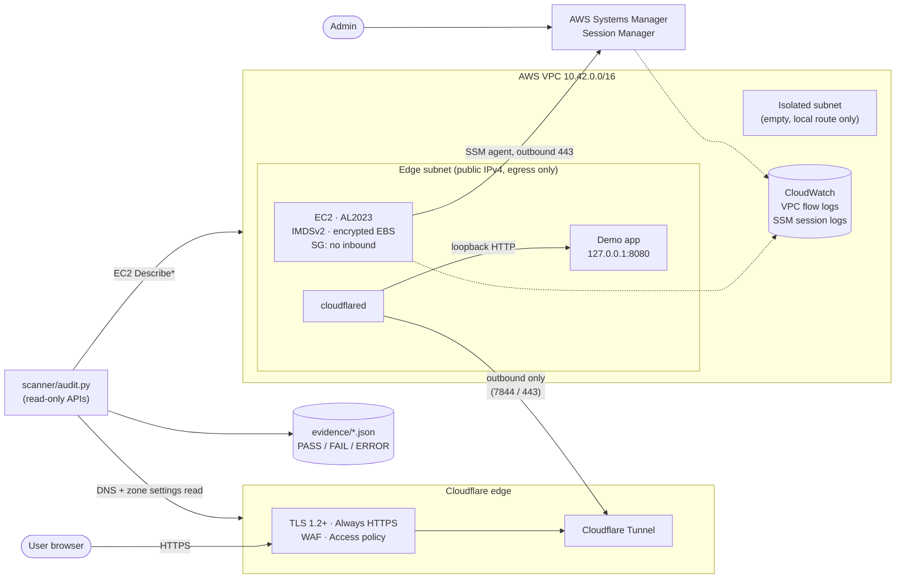

# CloudSecure AWS + Cloudflare — MVP

[](https://github.com/gkoufie1/cloudsecure/actions/workflows/ci.yml)

**What this shows:** a web origin on AWS with **zero inbound ports**, published only through a Cloudflare Tunnel and administered only through SSM, built in Terraform. A Python scanner collects **evidence across both platforms** (AWS and the Cloudflare edge) into one JSON report and maps each check to a PCI DSS v4.0 requirement. A break → scan → fix → scan drill produces before-and-after evidence, with the Terraform plan as change approval.

**Skills:** Terraform · AWS VPC, EC2, IAM, SSM, CloudWatch · Cloudflare Tunnel, WAF, Access · Python (boto3) · CI with Checkov and unit tests · compliance evidence mapping.

A lab security assessment, not a PCI compliance certification. No actual card data. Use a dedicated AWS account and a dedicated Cloudflare test zone.

## Architecture



No path into the instance starts from the internet: both `cloudflared` and the SSM agent open connections outbound, so the security group has no inbound rules at all.

## 1. Management host
On Ubuntu with Terraform >=1.6, AWS CLI v2, Python 3, python3-venv and unzip installed, configure AWS access through temporary credentials or an authorized management instance role. Never use root keys. Set an AWS Budget alert (not a hard spending cap).

## 2. Deploy AWS
```
cd terraform
terraform init
terraform validate
terraform plan -out=lab.tfplan
terraform apply lab.tfplan
terraform output
```
This cost-conscious MVP uses one EC2 with a public IPv4 for outbound access, no inbound rules, no NAT gateway, and an empty isolated subnet. It is NOT a fully private or multi-AZ architecture. The app listens exclusively on loopback. SSM is the administration path. Allow several minutes for registration and bootstrap.

The VPC's default security group is stripped of all rules. VPC flow logs and SSM session transcripts go to the CloudWatch log groups shown in `terraform output` (retention: `log_retention_days`, default 90). Session logging is configured through the account- and region-wide `SSM-SessionManagerRunShell` document. If that document already exists in your account, apply fails with `DocumentAlreadyExists`: either `terraform import 'aws_ssm_document.session_prefs[0]' SSM-SessionManagerRunShell` or set `-var manage_session_manager_preferences=false`. Note that `terraform destroy` deletes this document.

The AMI is pinned at first apply: new Amazon Linux releases do not replace the instance. To move to the latest AMI on purpose, run `terraform apply -replace=aws_instance.origin`. Editing `bootstrap.sh` replaces the instance on the next apply, because user data only runs on first boot.

## 3. Connect Cloudflare
Use a dedicated domain already active on Cloudflare. Avoid changing existing business DNS or mail. In AWS Systems Manager > Session Manager open a session to the instance. Or use `aws ssm start-session --target INSTANCE_ID` with the local Session Manager plugin. Run `curl http://127.0.0.1:8080/health`. In Cloudflare Networking > Tunnels create a remotely managed tunnel. Choose Linux x86_64 and follow the dashboard installation instructions for Amazon Linux (RPM). Install the service using the displayed command in the SSM session; treat the tunnel token as a secret, never commit it. Add a published application route for your test hostname to `http://localhost:8080`. The local hop is loopback HTTP, not independent origin TLS. Protect the entire hostname using Cloudflare Access and an explicit allow policy before making the route public if you want a private demo. Use only synthetic data even if the demo is public.

## 4. Edge controls
In the dedicated test zone configure minimum TLS 1.2 or higher, HTTPS redirect, available managed WAF rules, and a custom rule blocking `/blocked-test`. Verify with curl and dashboard security events. Configure Access with your approved identity provider; verify an unauthorized browser is denied. Feature availability depends on plan. Do not change zone-wide settings on an existing production zone. Cloudflare configuration is manual in this MVP to avoid storing tunnel credentials in Terraform state.

## 5. Scan
From the repository root:
```
python3 -m venv .venv
source .venv/bin/activate
pip install -r requirements.txt
mkdir -p evidence
python scanner/audit.py --region REGION --vpc VPC_ID --output evidence/baseline.json
```
`--region` defaults to `us-east-1` and must match the Terraform `region` variable (see `terraform output region`). Each check is recorded as PASS, FAIL, ERROR or NOT_TESTED; an API or permission error becomes an ERROR finding rather than aborting the scan. Exit code: 0 all tested checks passed, 1 at least one FAIL, 2 at least one ERROR and no FAIL.
For combined scanning create a scoped Cloudflare read token with DNS Read and Zone Settings Read for the lab zone. `read -rs CLOUDFLARE_API_TOKEN; export CLOUDFLARE_API_TOKEN` then enter token. Run `python scanner/audit.py --region REGION --vpc VPC_ID --zone ZONE_ID --hostname lab.example.com --output evidence/combined.json`. Use read-only AWS EC2 Describe permissions for the scanner. An API error is not evidence of compliance. Zone-wide TLS settings do not establish end-to-end TLS compliance.

## 6. Safe remediation drill
On the isolated lab instance only, change Terraform metadata http_tokens to optional, apply, scan, then revert to required, apply and scan again. Do not introduce open inbound access. Compare baseline and after JSON. Use Terraform plan as approval evidence. Test denied inbound access using security group configuration, not attacks against other systems.

## 7. Design decisions

| Decision | Why | Production alternative |
|---|---|---|
| **Cloudflare Tunnel instead of a load balancer** | The origin has no inbound ports, so there's nothing to port-scan and no security group rule to get wrong. TLS, WAF and Access are enforced at the edge before traffic reaches AWS. | An ALB in private subnets restricted to Cloudflare IPs, with origin TLS (Authenticated Origin Pulls), if you need AWS-native load balancing or multiple targets. |
| **SSM Session Manager instead of SSH** | No key pairs to manage, no port 22, IAM-controlled access, and every session is logged to CloudWatch. | The same approach, plus a customer-managed KMS key for session encryption. |
| **Public IPv4 for egress instead of a NAT gateway** | A NAT gateway costs about $32/month plus data charges, which is most of this lab's budget. The public IP is egress-only because the security group has no inbound rules. | Private subnets with a NAT gateway or egress firewall, and VPC endpoints for SSM, logs and S3. |
| **Cloudflare configured by hand instead of in Terraform** | A Terraform-managed tunnel puts its token in Terraform state. Keeping it manual means no secret ever lands in state or the repo. | The Cloudflare Terraform provider with an encrypted remote state backend and the token in a secrets manager. |
| **Scanner records errors instead of crashing** | A failed API call is not evidence that a control passes. Each check fails independently as `ERROR`, the report is always written, and the exit code tells automation what happened. | Feed the same evidence into Security Hub or a GRC tool; use AWS Config rules for continuous checks. |
| **AMI pinned at first apply** | A new Amazon Linux release would otherwise replace the instance on the next plan, changing the instance ID mid-drill and muddying the evidence. Updating the AMI is an explicit `-replace`. | A baked-AMI pipeline (EC2 Image Builder) with planned rollouts. |
| **Default CloudWatch encryption and 90-day retention** | KMS keys and year-long retention add cost for no lab value. These are recorded as inline Checkov skips with reasons, not hidden. | Customer-managed KMS keys and 365-day retention (PCI DSS 10.5.1). |

**Accepted Checkov exceptions** are listed with their reasons as `#checkov:skip` comments in [terraform/main.tf](terraform/main.tf). Any new finding fails CI.

### Continuous integration
[`.github/workflows/ci.yml`](.github/workflows/ci.yml) runs on every push and pull request:
- `terraform fmt -check` and `terraform validate`
- Checkov IaC security scan
- the scanner's offline unit tests (AWS and Cloudflare are mocked, so no credentials are needed)
- ShellCheck on `bootstrap.sh`

To run the tests locally: `python -m unittest discover -s tests -v`

## 8. Extend
Add a 12-month log retention setting with KMS encryption, private subnets with NAT/controlled egress, private encrypted RDS with TLS, separate application and data security groups, Windows SSM managed host, Config/Security Hub, Inspector, CloudTrail retention, WAF/Access API checks, and approval-based remediation. These are future work, not deployed by this starter. See compliance/controls.csv. Capture actual evidence, not invented metrics.

## 9. Cleanup
Delete the lab published route/DNS record, Access application and tunnel in Cloudflare, revoke the lab API token. From terraform run `terraform destroy` and verify EC2, EBS, public IPv4 and VPC removal. Manually enabled account-level security services may continue billing. Remove management host separately if no longer needed. Keep sanitized reports only.

References: https://developers.cloudflare.com/tunnel/get-started/ ; https://developers.cloudflare.com/tunnel/reference/tunnel-tokens/ ; https://www.pcisecuritystandards.org/document_library/
