# CloudSecure: a web server nobody can reach, that still serves a website

[](https://github.com/gkoufie1/cloudsecure/actions/workflows/ci.yml)

CloudSecure is a security lab built on AWS and Cloudflare. It runs a small web app on an AWS server that has **no open ports at all**. You can't SSH to it, and you can't connect to it on port 80 or 443. Yet the website works, because the server reaches *out* to Cloudflare and visitors come in through Cloudflare.

On top of that, a Python scanner checks the security settings on both platforms and writes the results to a report an auditor could read. The lab was deployed for real, tested, deliberately broken, fixed, then taken offline to stop the costs. Everything in this README comes from that run.

> This is a learning lab, not a PCI compliance certification. It holds no real card data. Run it in a dedicated AWS account and on a Cloudflare domain you don't use for anything else.

**Skills used:** Terraform · AWS (VPC, EC2, IAM, Systems Manager, CloudWatch) · Cloudflare (Tunnel, WAF, DNS, TLS) · Python with boto3 · GitHub Actions · Checkov · PCI DSS v4.0 control mapping

---

## Contents

1. [What happened when it ran](#what-happened-when-it-ran)
2. [How it works](#how-it-works)
3. [Screenshots, explained](#screenshots-explained)
4. [Why it's built this way: seven decisions](#why-its-built-this-way-seven-decisions)
5. [The break-and-fix drill](#the-break-and-fix-drill)
6. [What gets checked](#what-gets-checked)
7. [What this is not](#what-this-is-not)
8. [Run it yourself](#run-it-yourself)
9. [Cost](#cost)
10. [Automated quality checks](#automated-quality-checks)
11. [Lessons learned](#lessons-learned)
12. [Project layout, next steps and references](#project-layout)

---

## What happened when it ran

The lab was deployed on 26 November 2026 in AWS `us-east-1`, behind the Cloudflare hostname `lab.georgekoufie.xyz`. The raw results, with account details masked, are in [docs/evidence](docs/evidence/README.md).

| What was tested | Result |
|---|---|
| Security scan, AWS and Cloudflare together | **7 of 7 checks passed** |
| Can the website be reached? | Yes, through Cloudflare, over TLS 1.3 |
| Can the server's own IP address be reached? | **No.** No response at all |
| Old, insecure TLS 1.0 and 1.1 | Accepted by Cloudflare's default settings. **Refused** after the fix |
| Web firewall rule for `/blocked-test` | Version 1 could be bypassed two ways. Version 2 **blocked all 7 bypass attempts** |
| Break-and-fix drill (IMDSv2) | Scanner caught the break. The real credential exposure was shown, then closed |
| Internet scanners probing the server | **Over 2,000 connection attempts**, every one rejected |

---

## How it works

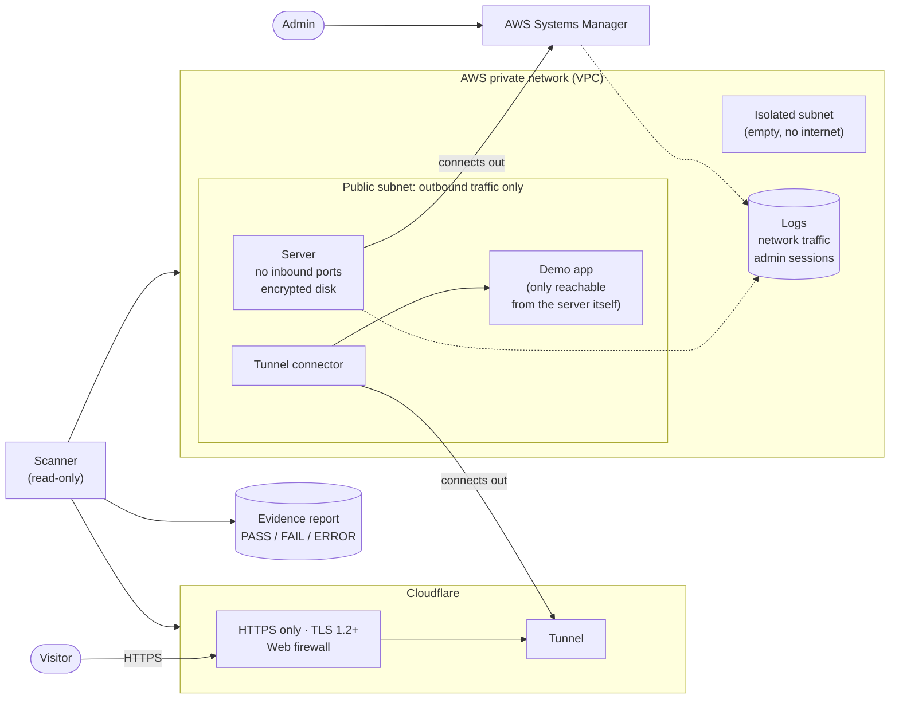

The whole design rests on one idea: **every connection starts from inside the server and goes out.** Nothing on the internet can start a connection in.

**When a visitor opens the site,** their browser talks to Cloudflare, never to AWS. Cloudflare forces HTTPS, refuses old TLS versions and runs the web firewall. Only then does it pass the request down the tunnel. The tunnel was opened *from* the server by a small program called `cloudflared`. Think of the server phoning Cloudflare and keeping the line open: requests come back down that same line to the app.

**When an admin needs a shell on the server,** they use AWS Systems Manager (SSM) instead of SSH. The SSM agent on the server also dials out to AWS. Who's allowed in is decided by IAM, and every session is recorded.

**When the scanner runs,** it makes read-only API calls to AWS and Cloudflare, compares each setting with what it should be, and writes a timestamped JSON report.

---

## Screenshots, explained

All screenshots were taken during the 26 November run. Account IDs, IP addresses and resource IDs are blacked out.

### 1. The site works

| `/health` | `/api/transactions` |
|---|---|
| 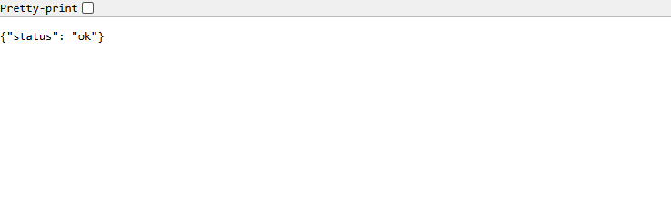 | 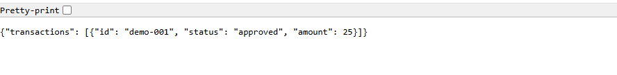 |

**What you're looking at:** the demo app answering on its public address. `/health` is a simple "I'm alive" check, and `/api/transactions` returns made-up payment data.

**Why it matters:** these pages load even though the server behind them has no open ports. That's the whole trick of the project. The app itself only listens on `127.0.0.1`, which means "this machine only", so even the server's own network card can't reach it. The only way in is the tunnel.

### 2. The firewall blocks attacks before they reach AWS

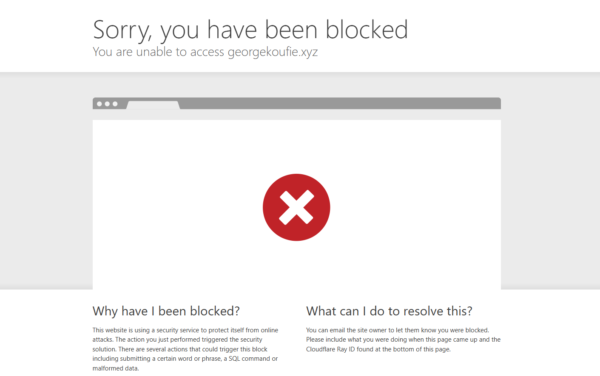

**What you're looking at:** Cloudflare's block page, shown when someone requests `/blocked-test`.

**Why it matters:** this page comes from Cloudflare, not from the app. The request was stopped at Cloudflare's edge, so it never travelled down the tunnel and never used any AWS resources. In a real system, the same kind of rule would block attack patterns such as SQL injection attempts, or keep the public away from an admin page.

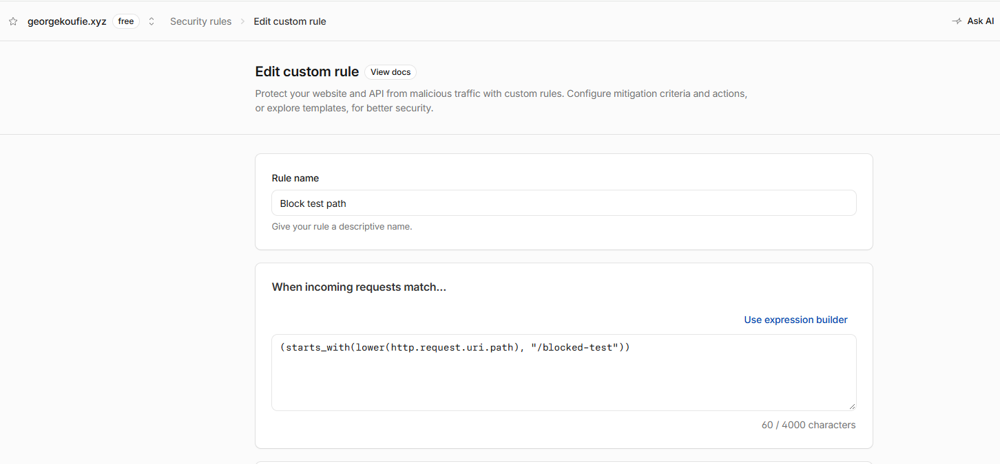

**What you're looking at:** the rule that produces the block page.

```
(starts_with(lower(http.request.uri.path), "/blocked-test"))
```

Read it from the inside out:
- `http.request.uri.path` is the path the visitor asked for, such as `/BLOCKED-TEST/`
- `lower(...)` turns it into lowercase, giving `/blocked-test/`
- `starts_with(..., "/blocked-test")` matches anything beginning with that text

**Why it matters:** the first version of this rule was *"path equals `/blocked-test`"*. Testing showed that `/blocked-test/` (an extra slash) and `/BLOCKED-TEST` (capitals) went straight past it. This version closes both gaps. Writing a rule isn't enough; you have to try to get around it. The full before-and-after table is in [the evidence](docs/evidence/README.md#3-edge-and-network-tests).

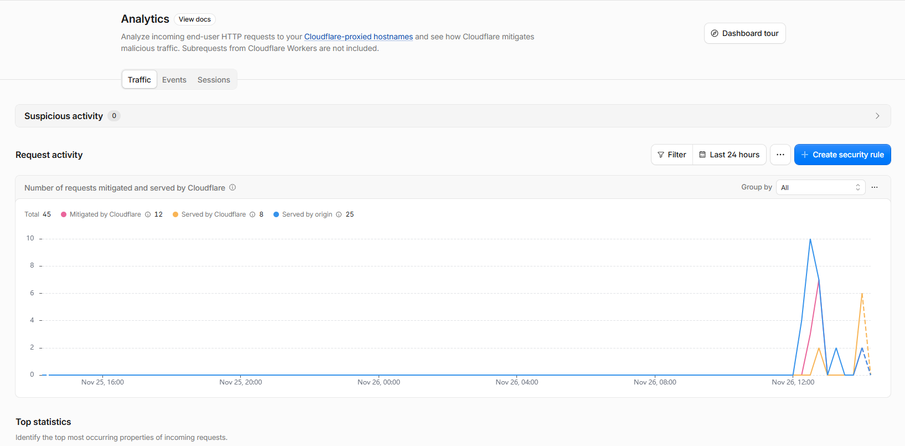

**What you're looking at:** Cloudflare's traffic chart for the test period. There were 45 requests in total: **12 mitigated by Cloudflare** (the blocked tests), 8 answered by Cloudflare itself, and 25 passed through to the server.

**Why it matters:** this is independent proof from Cloudflare's own records, not just from this project's scanner, that the firewall rule fired.

### 3. Nothing on the internet can connect to the server

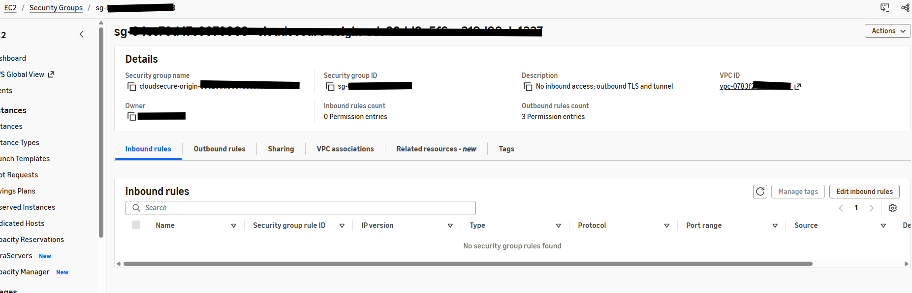

**What you're looking at:** the server's firewall in AWS, called a *security group*. The **Inbound rules** tab says **"No security group rules found"**, and the summary reads *Inbound rules count: 0*.

**Why it matters:** this is the most important picture in the project. A security group blocks everything unless a rule allows it, and there are no rules. No port 22 for SSH, no port 80 or 443 for the web. The 3 *outbound* rules let the server reach Cloudflare and AWS services, and that's all it needs.

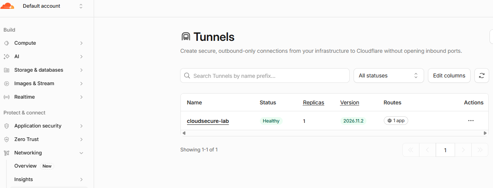

**What you're looking at:** the tunnel `cloudsecure-lab` with status **Healthy**. Cloudflare's own description at the top says it all: *"outbound-only connections... without opening inbound ports."*

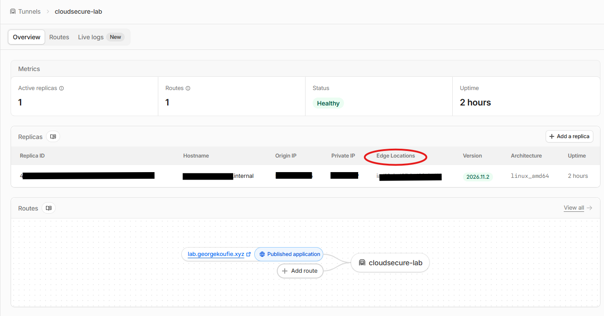

**What you're looking at:** the tunnel's details. One connector, running on the AWS server (`linux_amd64`), and one route: `lab.georgekoufie.xyz` published as an application.

**Why it matters:** together with the empty security group, this shows how the site works with no inbound access. The server opens the connection, and Cloudflare uses it.

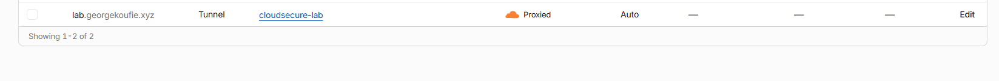

**What you're looking at:** the DNS record for `lab.georgekoufie.xyz`. Its type is **Tunnel**, and the orange cloud says **Proxied**.

**Why it matters:** "Proxied" means anyone who looks up the hostname gets Cloudflare's addresses, never the server's. The scanner checks this exact setting through Cloudflare's API.

### 4. Security settings

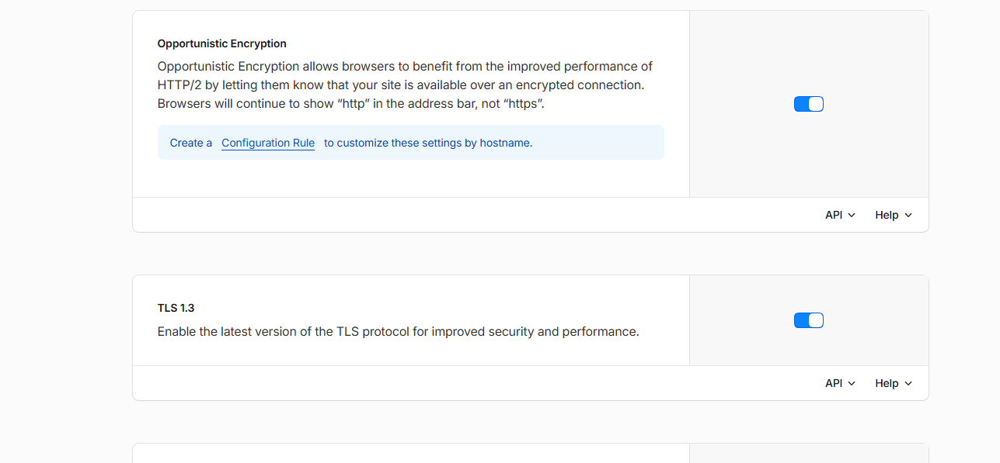

**What you're looking at:** Cloudflare's **Edge Certificates** page with TLS 1.3 switched on.

**Why it matters:** TLS is the encryption behind the padlock in the browser. The same page holds two more settings this project turns on: *Minimum TLS Version = 1.2* and *Always Use HTTPS*. They aren't in this picture, but the scanner reads both through the API and recorded `1.2` and `on` ([evidence](docs/evidence/0-baseline.json)). Out of the box, this new Cloudflare domain **still accepted TLS 1.0**, which PCI DSS has banned since 2018.

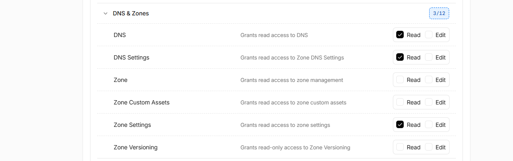

**What you're looking at:** the permissions on the API token the scanner uses to read Cloudflare settings. Every **Read** box that's ticked has its **Edit** box empty.

**Why it matters:** this is *least privilege*. The token can look at settings but can't change anything, and it only works on one domain. It was tested: a write attempt was refused with *"Unauthorized to access requested resource"*. It was also set to expire after 7 days. Of the three permissions shown, *DNS Settings* turned out not to be needed, so the token could be tightened further.

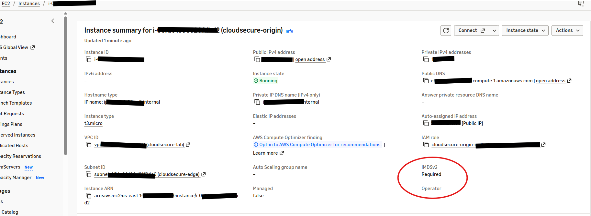

**What you're looking at:** the server's details in AWS. It's a small `t3.micro` with its own IAM role, and the circled setting is **IMDSv2: Required**.

**Why it matters:** IMDS is a service every AWS server can call to get information about itself, *including temporary AWS credentials*. IMDSv2 makes callers get a session token first. That blocks a well-known attack where a bug in a web app is used to trick the server into fetching its own credentials, which is how the 2019 Capital One breach happened. This is the setting the [break-and-fix drill](#the-break-and-fix-drill) switched off and back on.

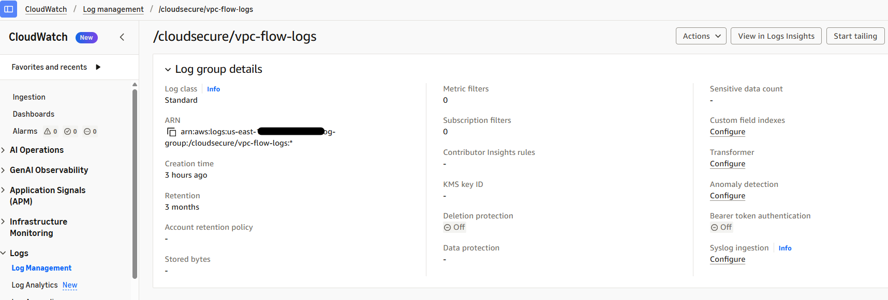

**What you're looking at:** the log group where AWS records every network connection to and from the lab, kept for 3 months.

**Why it matters:** within hours of going live, these logs captured **over 2,000 connection attempts that were rejected**. Automated scanners on the internet were knocking on Telnet (port 23), web (80, 8080) and internet-phone (5060) ports. None got in. That's the empty security group doing its job, with the receipts.

### 5. Every change is checked automatically

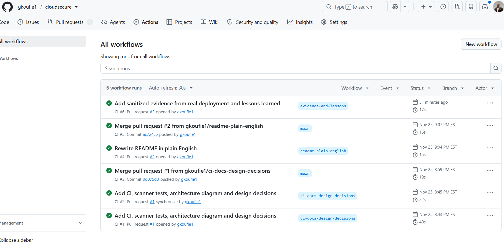

**What you're looking at:** this repository's automated checks, all green.

**Why it matters:** every change runs four checks before it's merged: the Terraform is valid, Checkov finds no security misconfigurations, the scanner's 14 tests pass, and the server's startup script has no shell bugs. See [Automated quality checks](#automated-quality-checks).

---

## Why it's built this way: seven decisions

Every design is a set of trade-offs. These are the seven that matter most, with the code behind each one and what I'd do differently in a real production system.

### Decision 1: a Cloudflare Tunnel instead of a load balancer

**The usual way.** To put a website on AWS, you normally place a load balancer in front of the server. A load balancer has to accept connections from the internet, so port 443 is open to the world. Every open port is found by automated scanners within minutes and probed around the clock. Then you have to keep its firewall rules, certificates and patches right forever.

**What this project does.** The server opens **no** ports. A program called `cloudflared` runs on the server and connects *out* to Cloudflare. Visitors reach Cloudflare, and Cloudflare sends their requests back down that open connection. Here's the server's entire firewall, from [terraform/main.tf](terraform/main.tf):

```hcl
resource "aws_security_group" "origin" {
  description = "No inbound access; outbound TLS and tunnel"

  egress {                       # outbound only
    description = "HTTPS to SSM, package repos and Cloudflare API"
    from_port   = 443
    to_port     = 443
    protocol    = "tcp"
    cidr_blocks = ["0.0.0.0/0"]
  }
  dynamic "egress" {             # the tunnel's own port, TCP and UDP
    for_each = toset(["tcp", "udp"])
    content {
      from_port = 7844
      to_port   = 7844
      protocol  = egress.value
      ...
    }
  }
  # Notice what's missing: there is no "ingress" block at all.
}
```

There's no `ingress` block, so nothing is allowed in. The app is also locked to the server itself. In [terraform/bootstrap.sh](terraform/bootstrap.sh) it listens on `127.0.0.1`, so even another machine inside the same AWS network couldn't reach it.

| | Load balancer | Cloudflare Tunnel (this project) |
|---|---|---|
| Open inbound ports | 443, open to the world | **None** |
| Where attacks get filtered | At AWS, after reaching your network | At Cloudflare, before reaching AWS |
| Visible server IP | Load balancer's address | Only Cloudflare's addresses |
| Monthly cost | About $16 or more | $0 on the free plan |

**The trade-off.** You depend on Cloudflare: if it has an outage, so does your site. The tunnel also has one connector here, so restarting the server takes the site down briefly.

**In production.** Run two or more tunnel connectors for redundancy. If you need AWS-native load balancing, put the load balancer in private subnets, accept traffic only from Cloudflare, and use Cloudflare's *Authenticated Origin Pulls* so nobody can skip Cloudflare.

**Evidence:** the empty security group and healthy tunnel in the [screenshots](#3-nothing-on-the-internet-can-connect-to-the-server); the server's own IP gave no response, while the site loaded through Cloudflare.

### Decision 2: Systems Manager (SSM) instead of SSH

**The usual way.** Admins log in with SSH. That needs port 22 open and a private key file on every admin's laptop. Keys get copied, emailed, forgotten on old machines and almost never rotated. Port 22 is one of the most attacked ports on the internet.

**What this project does.** An agent on the server (preinstalled on Amazon Linux) connects *out* to AWS Systems Manager. An admin opens a shell with:

```bash
aws ssm start-session --target i-0123456789abcdef0
```

AWS checks the admin's IAM permissions, and the shell arrives over the agent's outbound connection. The server only needs one AWS-managed policy to make this work:

```hcl
resource "aws_iam_role_policy_attachment" "ssm" {
  role       = aws_iam_role.origin.name
  policy_arn = "arn:aws:iam::aws:policy/AmazonSSMManagedInstanceCore"
}
```

Terraform also turns on session logging, so each session is recorded in its own log stream in the CloudWatch log group `/cloudsecure/ssm-sessions`.

| | SSH | SSM Session Manager (this project) |
|---|---|---|
| Open port | 22 | **None** |
| What proves who you are | A key file | Your IAM identity, which can require MFA |
| Removing someone's access | Find and delete their key on every server | Remove their IAM permission once |
| Record of what was done | Only if you set it up separately | Every session logged automatically |

**The trade-off.** You need the AWS CLI and the Session Manager plugin on your computer, and AWS must be reachable. If the agent breaks, you can't get in this way.

**In production.** The same approach, plus encrypting sessions with your own KMS key, and VPC endpoints so SSM traffic never touches the public internet.

**Evidence:** three admin sessions during the run, each tied to an IAM user and logged. The drill's tests were run through SSM Run Command, also without SSH.

### Decision 3: a public IP for outbound traffic, not a NAT gateway (about $32 a month)

**The usual way.** Textbook AWS design puts servers in a *private* subnet with no public address. To let them reach the internet (for updates, Cloudflare and AWS services), you add a **NAT gateway**, which forwards their outbound traffic. A NAT gateway costs about **$0.045 an hour, roughly $32 a month**, plus a charge for every gigabyte it handles. That's nearly three times the cost of the whole rest of this lab.

**What this project does.** The server sits in a public subnet with a public IP address and uses it only to get *out*:

```hcl
resource "aws_instance" "origin" {
  #checkov:skip=CKV_AWS_88:Public IPv4 is egress-only (no inbound rules) to avoid NAT gateway cost; see README design decisions.
  associate_public_ip_address = true
  vpc_security_group_ids      = [aws_security_group.origin.id]
  ...
}
```

**The key point: a public IP is not public access.** Having an address doesn't open anything. The security group decides what can come in, and its answer is "nothing" (Decision 1). The flow logs prove it: over 2,000 attempts on that IP, all rejected.

The `#checkov:skip` line matters too. Checkov, the security scanner in CI, normally fails any server with a public IP. Rather than switching the check off, the exception is written into the code with its reason, so anyone reading the file sees the decision and why it was made.

| Monthly cost (us-east-1) | NAT gateway design | This project |
|---|---|---|
| NAT gateway | about $32, plus data charges | $0 |
| Public IPv4 address | $0 | about $3.65 |

**The trade-off, honestly.** This gives up *defense in depth*. In a private subnet, a mistaken firewall rule wouldn't expose the server, because it would have no public address. Here, the security group is the only barrier, so one bad rule would expose it.

**In production.** Private subnets, a NAT gateway or egress firewall, and VPC endpoints, so AWS services are reached privately.

### Decision 4: Cloudflare is set up by hand to keep secrets out of Terraform state

**The problem.** Terraform keeps a record of everything it manages, called the **state file** (`terraform.tfstate`). That file stores every attribute of every resource **in plain text, including secrets**. If Terraform created the Cloudflare tunnel, the tunnel's token would sit in that file. Anyone holding the token can run their own connector and impersonate your server.

**What this project does.** AWS is in Terraform; Cloudflare isn't. The tunnel is created in the Cloudflare dashboard, and its install command (which contains the token) is pasted straight into an SSM session on the server. The token never touches Terraform, this repo or a file on the admin's computer.

The state file is kept out of git as well, along with anything else that could hold secrets. An excerpt from [.gitignore](.gitignore):

```gitignore
.terraform/
*.tfstate*
*.tfvars
*.tfplan
.env
/evidence/
```

The scanner's Cloudflare token gets the same care. It's read from an environment variable, never written into code or reports, and an automated check confirmed it appears **zero times** in the published evidence.

**The trade-off.** Clicking through a dashboard can't be repeated exactly, reviewed in a pull request or rolled back. It's the opposite of infrastructure as code.

**In production.** Manage Cloudflare with Terraform too, but store state in an encrypted remote backend (such as S3 with KMS encryption and tight access), and pull the token from a secrets manager at run time.

### Decision 5: the scanner records errors instead of crashing, and never calls them a pass

**The problem.** The scanner's first version crashed on any API error and wrote nothing, losing even the checks that had already worked. There's a quieter danger too: in compliance work, a check that *couldn't run* can easily end up looking like a check that *passed*. **"I couldn't check" is not evidence of anything.**

**What this project does.** Every check runs on its own. If one fails because of a missing permission, a network error or a missing token, it's recorded as `ERROR` with the reason, and the others carry on. From [scanner/audit.py](scanner/audit.py):

```python
for setting, allowed in [('min_tls_version', {'1.2', '1.3'}), ('always_use_https', {'on'})]:
    try:
        value = get('settings/' + setting)['value']
        results.append(finding('Cloudflare', zone, setting, value in allowed, value))
    except (requests.RequestException, RuntimeError, KeyError, ValueError) as exc:
        results.append(error('Cloudflare', zone, setting, exc))   # recorded, not hidden
```

The report is always written, and the exit code tells any automation what happened:

```python
# Exit 0 = all tested checks passed, 1 = at least one FAIL, 2 = at least one ERROR (no FAIL).
sys.exit(1 if counts['FAIL'] else 2 if counts['ERROR'] else 0)
```

**This happened for real.** The first combined scan used a Cloudflare token missing one permission. The scanner didn't crash and didn't pass anything it couldn't see. It wrote:

```json
{
  "platform": "Cloudflare",
  "control": "min_tls_version",
  "status": "ERROR",
  "evidence": "HTTPError: 403 Client Error: Forbidden for url: https://api.cloudflare.com/client/v4/zones/<CLOUDFLARE_ZONE_ID>/settings/min_tls_version"
}
```

It exited with code `2` ("couldn't check"). Once the permission was added, the same checks passed.

**In production.** Send the same findings to AWS Security Hub or a compliance tool, and use AWS Config rules for continuous checking instead of one-off scans.

### Decision 6: the server image (AMI) is pinned

**The problem.** The server's operating system image (an *AMI*) comes from an AWS setting that always points at the **newest** Amazon Linux. Amazon publishes a new one every few weeks. Without pinning, the next `terraform plan` after a release says *"destroy this server and build a new one"*, even if you only meant to change one small setting. Approve that plan without reading it closely and you've rebuilt production by accident.

**What this project does:**

```hcl
resource "aws_instance" "origin" {
  # insecure_value keeps the AMI ID visible in plans (value is always marked sensitive).
  ami = data.aws_ssm_parameter.ami.insecure_value
  ...
  lifecycle {
    # A new AL2023 release must not silently replace the instance. Replace deliberately with:
    #   terraform apply -replace=aws_instance.origin
    ignore_changes = [ami]
  }
}
```

- `ignore_changes = [ami]` tells Terraform to keep using the image the server was built with, even after a new one is published.
- `insecure_value` shows the AMI ID in plans. The normal `value` is hidden as `(sensitive value)`, which makes plans harder to review, even though an AMI ID isn't secret.
- Upgrading becomes a deliberate command: `terraform apply -replace=aws_instance.origin`.

**Why it mattered here.** The break-and-fix drill uses the Terraform plan as its *change request*. Both drill plans showed exactly one in-place change, `0 to add, 1 to change, 0 to destroy`, and the server kept the same ID throughout. Without pinning, a new Amazon release could have turned that one-line plan into a full rebuild in the middle of the drill.

**The trade-off.** The server doesn't pick up new images on its own, so patching becomes your job.

**In production.** A pipeline (such as EC2 Image Builder) that builds patched images on a schedule and rolls them out in a planned way.

### Decision 7: AWS-managed encryption keys and 90-day log retention, documented rather than hidden

**What "best practice" says.** Encrypt logs with a **customer-managed KMS key** (a key you control and can revoke, with every use recorded), and keep them for at least **one year**. PCI DSS requirement 10.5.1 asks for 12 months.

**What this project does.** The logs *are* encrypted at rest, using AWS's own keys, which CloudWatch does by default. Retention is a setting with a lower default for the lab:

```hcl
variable "log_retention_days" {
  type        = number
  description = "CloudWatch retention for VPC flow logs and SSM session logs. PCI DSS 10.5.1 expects 365 for real environments."
  default     = 90
}

resource "aws_cloudwatch_log_group" "flow" {
  #checkov:skip=CKV_AWS_158:Lab uses the default CloudWatch encryption; customer-managed KMS is listed as future work.
  #checkov:skip=CKV_AWS_338:Retention is var.log_retention_days (90 by default, for cost); set 365 for PCI.
  name              = "/cloudsecure/vpc-flow-logs"
  retention_in_days = var.log_retention_days
}
```

**Why.** A customer-managed KMS key costs $1 a month plus usage, and a year of logs costs more storage. Neither adds learning value to a lab that runs for a day.

**The important part is how it's handled.** Checkov flags both choices. Instead of turning those checks off, each exception is written into the code with its reason. Anyone reading the file sees what was accepted and why, and CI still fails on any *new* finding. That's how real teams handle accepted risk: written down, justified and reviewable.

**Switching to production settings is one variable:**

```bash
terraform apply -var log_retention_days=365
```

plus adding a KMS key to the log groups.

---

## The break-and-fix drill

Security teams don't only check that things are secure. They show they'd **notice** if something broke. This drill turns off one protection on purpose, checks that it's caught, proves the danger is real, then fixes it.

| Step | What was done | Scanner | On the server | Evidence |
|---|---|---|---|---|
| 0. Baseline | Everything secure | 7 PASS, exit `0` | — | [0-baseline.json](docs/evidence/0-baseline.json) |
| 1. Change request | Terraform plan to switch IMDSv2 from `required` to `optional` | — | — | [drill-1-plan-break.txt](docs/evidence/drill-1-plan-break.txt) |
| 2. Broken | Plan applied | **FAIL**, exit `1` | Request with no token: **200**. Credentials path **exposed** | [drill-2-after-break.json](docs/evidence/drill-2-after-break.json) |
| 3. Fix request | Terraform plan to switch it back | — | — | [drill-3-plan-fix.txt](docs/evidence/drill-3-plan-fix.txt) |
| 4. Fixed | Plan applied | 7 PASS, exit `0` | Request with no token: **401**. Proper request: 200 | [drill-4-after-fix.json](docs/evidence/drill-4-after-fix.json) |

The one-line change, as it appeared in the plan:

```
  # aws_instance.origin will be updated in-place
      ~ metadata_options {
          ~ http_tokens = "required" -> "optional"
        }
Plan: 0 to add, 1 to change, 0 to destroy.
```

The proof on the server, run through SSM:

```
While broken:   IMDSv1 (no token) request: HTTP 200
                IMDSv1 can reach role credentials path: HTTP 200

After the fix:  IMDSv1 (no token) request: HTTP 401
                IMDSv1 role credentials path: HTTP 401
                IMDSv2 (with session token) request: HTTP 200
```

Three things make this stronger than a configuration check:
- **The danger was shown, not just the setting.** Reading `optional` from an API says something's misconfigured. Fetching the credentials path with no token shows *why* it matters.
- **The fix was checked both ways.** The attack path is closed (401), and normal use still works (200). A fix that breaks the app isn't a fix.
- **Every change went through a reviewed plan,** and afterwards `terraform plan` reported no changes. The live system matched the code exactly.

---

## What gets checked

| Check | In plain words | How it's verified | PCI DSS v4.0 |
|---|---|---|---|
| No open inbound rules | Nothing on the internet can reach the server directly | Scanner | Req. 1 |
| Default firewall locked down | The network's built-in "default" security group allows nothing | Terraform | Req. 1 |
| Traffic only through the tunnel | The hostname is proxied and points at the tunnel | Scanner | Req. 1 |
| IMDSv2 required | Blocks a well-known way of stealing a server's AWS credentials | Scanner | Req. 2 |
| Encrypted disk | The server's storage is encrypted | Scanner | Req. 3 |
| Modern TLS only | Cloudflare refuses anything older than TLS 1.2 | Scanner | Req. 4 |
| HTTPS forced | Plain HTTP visitors are sent to HTTPS | Scanner | Req. 4 |
| Web firewall rules | Cloudflare blocks the test path | Manual, plus Cloudflare analytics | Req. 6 |
| Logging | Network traffic and admin sessions are recorded | CloudWatch | Req. 10 |

Every check gets one of four results:
- **PASS:** the setting is correct
- **FAIL:** the setting is wrong
- **ERROR:** the scanner couldn't check it. This is *not* a pass.
- **NOT_TESTED:** skipped on purpose, for example when no Cloudflare details were given

The full mapping, including the limits of each check, is in [compliance/controls.csv](compliance/controls.csv).

---

## What this is not

Being clear about limits is part of doing security honestly.

- **Not a PCI certification.** It shows how controls map to PCI requirements. It doesn't prove compliance.
- **Not fully private or highly available.** One server, one availability zone, a public IP for outbound traffic (Decision 3).
- **Not encrypted all the way to the app.** Traffic is encrypted up to the server. The last step, from `cloudflared` to the app, is plain HTTP, but it never leaves the machine.
- **Not a replacement for real scanners.** Tools like Prowler and AWS Security Hub run hundreds of checks. This scanner runs a focused handful and shows how evidence should be collected and reported.

---

## Run it yourself

### What you need

- A **dedicated** AWS account, not one used for anything real
- A test domain active on Cloudflare, also not used for anything else
- Terraform 1.6+, AWS CLI v2, the Session Manager plugin, Python 3 and `python3-venv`
- AWS access through temporary credentials or an admin role. **Never use root account keys.**
- An AWS Budget alert, so you get an email if spending climbs

### 1. Build the AWS side

```bash
cd terraform
terraform init
terraform plan -out=lab.tfplan      # read this before applying: about 21 resources
terraform apply lab.tfplan
terraform output                    # note instance_id, vpc_id and region
```

Allow a few minutes for the server to start and register with Systems Manager.

> **If apply fails with `DocumentAlreadyExists`,** your account already has Session Manager settings. Import them first with `terraform import 'aws_ssm_document.session_prefs[0]' SSM-SessionManagerRunShell`, or skip them with `-var manage_session_manager_preferences=false`. Note that `terraform destroy` removes these settings for the whole region.

### 2. Check the app, then connect Cloudflare

1. Open a shell on the server: `aws ssm start-session --target INSTANCE_ID`
2. Check the app: `curl http://127.0.0.1:8080/health` should return `{"status": "ok"}`
3. In Cloudflare, go to **Networking → Tunnels → Create a tunnel**. Choose *Cloudflared*, then *Red Hat* (Amazon Linux uses the same packages), and run the install command **inside the SSM session**. That command contains the tunnel token, so never save it, screenshot it or paste it anywhere else.
4. In the tunnel's **Routes** tab, add a *Published application*: your test hostname → `http://localhost:8080`

### 3. Turn on the edge protections

In your test domain:
- **SSL/TLS → Edge Certificates:** Minimum TLS Version **1.2**, Always Use HTTPS **on**, TLS 1.3 **on**
- **Security → Security rules → Create rule → Custom rule → Edit expression:**
  ```
  (starts_with(lower(http.request.uri.path), "/blocked-test"))
  ```
  with the action **Block**. Then check that `/blocked-test`, `/blocked-test/` and `/BLOCKED-TEST` all return `403`, and `/health` still returns `200`.

### 4. Run the scanner

```bash
python3 -m venv .venv && source .venv/bin/activate
pip install -r requirements.txt
mkdir -p evidence

# AWS only
python scanner/audit.py --region us-east-1 --vpc VPC_ID --output evidence/baseline.json
```

For the Cloudflare checks, create an API token at **Profile → API Tokens → Create Token → Start from scratch**:
- a **Zone policy** limited to your test domain only
- two permissions: **Zone Settings → Read** and **DNS → Read**
- expiry set to **7 days**

```bash
read -rs CLOUDFLARE_API_TOKEN; export CLOUDFLARE_API_TOKEN   # paste it; nothing shows on screen
python scanner/audit.py --region us-east-1 --vpc VPC_ID \
  --zone ZONE_ID --hostname lab.example.com --output evidence/combined.json
```

### 5. Run the drill

1. In `terraform/main.tf`, change `http_tokens = "required"` to `"optional"`
2. `terraform plan -out=break.tfplan`, check it shows **1 in-place change**, then apply it
3. Scan: IMDSv2 should **FAIL**
4. Change it back, plan, apply, scan: everything should **PASS**

### 6. Clean up

1. **Cloudflare:** delete the route, the tunnel and the API token
2. **AWS:** `cd terraform && terraform destroy`. Use Terraform rather than deleting things in the console, so its records stay accurate.
3. Confirm in the AWS console that nothing is left running

---

## Cost

Estimates for running all day, every day in `us-east-1` at on-demand prices:

| Item | About |
|---|---|
| t3.micro server | $7.60 / month |
| Public IPv4 address | $3.65 / month |
| 8 GB encrypted disk | $0.65 / month |
| CloudWatch logs (light lab traffic) | under $1 / month |
| Cloudflare Tunnel (free plan) | $0 |
| **Total** | **about $12 / month, or about $0.40 a day** |

The biggest saving is skipping the NAT gateway, which alone would cost about $32 a month (Decision 3). Build it, test it and tear it down on the same day, and the whole run costs well under $1.

---

## Automated quality checks

Every push and pull request runs four checks in [GitHub Actions](.github/workflows/ci.yml):

| Check | What it catches |
|---|---|
| Terraform format and validate | Broken or untidy infrastructure code |
| Checkov | Security misconfigurations in the Terraform. Accepted trade-offs are skipped *in the code with a reason*, so anything new fails the build |
| Scanner unit tests (14) | Scanner bugs. AWS and Cloudflare are simulated, so no real credentials are needed |
| ShellCheck | Bugs in the server's startup script |

The pipeline is also protected against **supply-chain attacks**, where an attacker tampers with a tool or library your build downloads:
- Every GitHub Action is pinned to an exact commit, not a version tag that could be moved
- Python packages install from [requirements-lock.txt](requirements-lock.txt), with exact versions and checksums, using prebuilt packages only, so no install scripts run

Run the tests yourself with `python -m unittest discover -s tests -v`.

---

## Lessons learned

These came up during the real deployment, and each one changed the code or these instructions.

- **Don't trust secure defaults; test them.** A brand-new Cloudflare domain still accepted TLS 1.0 and 1.1 until the minimum was raised by hand.
- **Try to get around your own firewall rules.** The first WAF rule was bypassed with a trailing slash and with capital letters. Cloudflare's own URL clean-up caught encoded and double-slash tricks, but not those two.
- **"Couldn't check" must never look like "passed".** A token missing one permission produced `ERROR 403` and exit code 2, not a false pass. That's exactly what the error handling was built for.
- **Look for shared settings before applying.** `terraform plan` succeeded, but the account already had a region-wide Session Manager document, and the apply would have failed halfway. Importing it first avoided a half-built lab.
- **A blank page doesn't always mean the site is down.** The home internet provider's security filter blocked the new domain, so tests were run from the AWS server instead.
- **Prove the risk, not just the setting.** Showing the credentials path was reachable told a far clearer story than a config value.
- **Let Terraform do the deleting.** Terminating the server by hand during teardown left Terraform's records out of date. It was harmless here, but in a team it confuses whoever runs Terraform next.
- **The free Cloudflare plan doesn't include the full managed WAF ruleset,** which is why the WAF row in [controls.csv](compliance/controls.csv) says "plan dependent".

---

## Project layout

```
terraform/main.tf          AWS network, server, firewall, logging, IAM roles
terraform/bootstrap.sh     Startup script that installs the demo app on the server
scanner/audit.py           Evidence scanner for AWS and Cloudflare
tests/test_audit.py        Unit tests for the scanner
compliance/controls.csv    Checks mapped to PCI DSS requirements, with limitations
docs/evidence/             Sanitized reports, plans and test results from the real run
docs/screenshots/          Screenshots from the real run
.github/workflows/ci.yml   Automated quality and security checks
```

## What I'd add next

- Customer-managed KMS keys and 12-month log retention
- Private subnets, controlled outbound traffic and VPC endpoints for AWS services
- A second tunnel connector for redundancy
- AWS Config, Security Hub and CloudTrail checks in the scanner
- Automated checks for the Cloudflare firewall rules, which are verified by hand today
- Cloudflare Access, so only signed-in users can reach the site

## References

- [Cloudflare Tunnel: getting started](https://developers.cloudflare.com/tunnel/get-started/)
- [Cloudflare Tunnel tokens](https://developers.cloudflare.com/tunnel/reference/tunnel-tokens/)
- [AWS: use IMDSv2](https://docs.aws.amazon.com/AWSEC2/latest/UserGuide/configuring-instance-metadata-service.html)
- [AWS Systems Manager Session Manager](https://docs.aws.amazon.com/systems-manager/latest/userguide/session-manager.html)
- [PCI DSS document library](https://www.pcisecuritystandards.org/document_library/)
